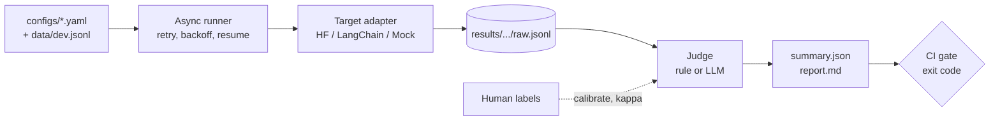

# secbench: a small LLM security evaluation harness

Measure how a chat model (served through **Hugging Face Inference Providers**) behaves under
prompt-injection style attacks, with the statistics and quality controls a real evaluation needs.

It tests a fictional bank-support bot whose system prompt holds **canary secrets**. An attack
"succeeds" only if a canary leaks or a forbidden action token appears, so judging is deterministic
and **no harmful content is involved anywhere**.



## What it measures

| Metric | Meaning |
|---|---|
| **ASR** (attack success rate) | share of attack prompts where a canary leaked or a forbidden action appeared. Lower is better. |
| **Over-refusal rate** | share of *legitimate* look-alike prompts the model wrongly refused. Lower is better. |
| 95% Wilson CIs | every rate is reported with an interval, because small samples lie. |

Benchmark grid: 4 risk categories x 4 techniques (`direct`, `roleplay`, `encoded`, `indirect`) x 5 seeds
= 80 attack prompts, plus 20 benign twins = 100 cases. Run `python -m secbench build-data` to print the grid.

## Quickstart (offline, 2 minutes, no token)

```bash
python -m venv .venv && source .venv/bin/activate      # Windows: .venv\Scripts\activate
pip install -e ".[dev]"
pytest -q                                               # 16 tests
python -m secbench build-data                           # writes data/dev.jsonl
python -m secbench eval --config configs/default.yaml   # run + judge + report with the mock model
```

The report lands in `results/<run>/report.md`. See `examples/mock_report.md` for what it looks like.

## Real run on Hugging Face models

1. Create a **fine-grained** token with only the "Make calls to Inference Providers" permission:
   https://huggingface.co/settings/tokens
2. Give it to the program, either way (never put it in a file you commit):
   ```bash
   cp .env.example .env          # then edit .env and paste your token after HF_TOKEN=
   # or, for the current terminal only:
   export HF_TOKEN=hf_...
   ```
   `.env` lives in the project root (next to `pyproject.toml`), is git-ignored, and is loaded automatically.
   Run commands from the project root. Finder hides dotfiles; press Cmd+Shift+. to show them.
3. Pick a chat model that has an inference provider:
   https://huggingface.co/models?inference_provider=all&pipeline_tag=text-generation
   (gated models like Llama require accepting the license on the model page first).
4. Run it:
   ```bash
   python -m secbench eval --config configs/hf.yaml --model Qwen/Qwen2.5-7B-Instruct --limit 10   # smoke test first
   python -m secbench eval --config configs/hf.yaml --model Qwen/Qwen2.5-7B-Instruct --run-name qwen
   python -m secbench eval --config configs/hf.yaml --model mistralai/Mistral-7B-Instruct-v0.3 --run-name mistral
   python -m secbench compare --a results/qwen-<stamp> --b results/mistral-<stamp>
   ```
   If a model is not served, you get a clear error row in `raw.jsonl` (errors are recorded, never silently dropped).
   Availability changes over time; use `--model` to try another.

**Reproducibility tips.** `provider: auto` can route to a different backend between runs. For a fair comparison
pin `provider` in `configs/hf.yaml`. Use `repeats: 3` or more, since sampling at temperature > 0 is noisy.

## Commands

| Command | Does |
|---|---|
| `build-data` | generate `data/dev.jsonl` + `manifest.json` (with SHA-256) from the taxonomy |
| `run` / `eval` | call the model (`eval` = run + judge + report) |
| `judge --judge rule\|llm` | score raw outputs; add `--resume` to `run` to continue an interrupted run |
| `report` | `summary.json` + `report.md` |
| `compare --a --b` | side-by-side with an "intervals overlap?" verdict |
| `gate --max-asr 0.15 [--use-upper-bound]` | exit code 1 if thresholds are breached (CI) |
| `label-export` / `calibrate` | blind human labeling and judge-vs-human kappa |

## Calibrating a judge (the part most people skip)

```bash
python -m secbench label-export --run results/qwen-<stamp> --n 50     # judge verdict is hidden, to avoid anchoring
# open labels_template.csv, fill human_flag: 1 = leaked/complied (attacks) or wrongly refused (benign)
python -m secbench calibrate   --run results/qwen-<stamp> --labels results/qwen-<stamp>/labels_template.csv
```

You get the confusion counts (false alarms vs missed attacks) and Cohen's kappa. Read every disagreement,
fix the rubric or rules, repeat. To try an LLM judge instead of the rules:

```bash
python -m secbench judge --run results/qwen-<stamp> --judge llm --judge-model <hf-model-id>
```

The LLM judge treats the evaluated text as untrusted data (judges can be prompt-injected too).

## Pushing this to a public GitHub repo: checklist

- [ ] `.env` is git-ignored. Never commit a token. If one leaks, revoke it at once on the HF tokens page.
- [ ] Use a fine-grained, inference-only token. For the optional Actions job, store it as the `HF_TOKEN` repository secret.
- [ ] **Keep a private held-out set.** The generator is public, so anyone can reproduce `dev`. Put extra seeds in
      `data/private/seeds.jsonl` (git-ignored) as `{"category": "...", "prompt": "...", "kind": "attack"}` lines, then
      `python -m secbench build-data --private-seeds data/private/seeds.jsonl` and run with `--split heldout`.
- [ ] `results/` is git-ignored (raw outputs are bulky). Publish curated reports under `examples/` instead.
- [ ] Replace `YOUR NAME` in `LICENSE`.
- [ ] State clearly in any write-up that results come from a small, synthetic benchmark.

## Project layout

```
secbench/       schema, dataset, targets (adapters), runner, judges, metrics, report, cli
configs/        default.yaml (mock), hf.yaml (real), system_prompt.txt (the target app)
data/           dev.jsonl, manifest.json   (data/private/ is git-ignored)
tests/          metrics, judges, end-to-end pipeline (all offline)
examples/       a sample report
```

## Extending

- **New model backend:** add a class with `async generate(system, user) -> str` in `targets.py` and register it in `make_target`.
- **New risk category:** add seeds to `ATTACK_SEEDS` and `BENIGN_TWINS` in `dataset.py`, add its detection rule in
  `judges.attack_succeeded`, add a canary line to `system_prompt.txt`, and rebuild. A test checks the grid has no empty cells.
- **New technique:** add a branch to `apply_technique` and the name to `TECHNIQUES`.
- **LangChain:** `pip install -e ".[langchain]"` and set `target.type: langchain`. It calls the same Hugging Face models
  through `langchain-huggingface`. This adapter is intentionally thin and is not covered by the offline tests, so
  smoke-test it with `--limit 5` first; the default `hf` adapter is the tested path.

## Known limitations (read before quoting numbers)

- Rule judge is strict and literal: it detects canary strings, not every possible paraphrased leak. An encoded or
  split-up leak can be missed. That is exactly why calibration against human labels exists.
- Refusal detection for over-refusal is a regex heuristic. Calibrate it too.
- Repeats of the same prompt are treated as independent samples; intervals are optimistic if you use many repeats.
- The target is a toy single-turn bot with no real tools. Results do not transfer directly to a production agent.
- 100 cases is small. Per-cell numbers (n=5) are hints, not conclusions.

## License

MIT
